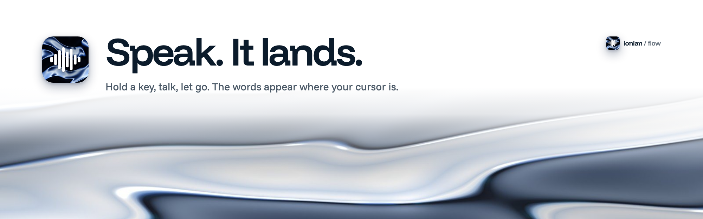
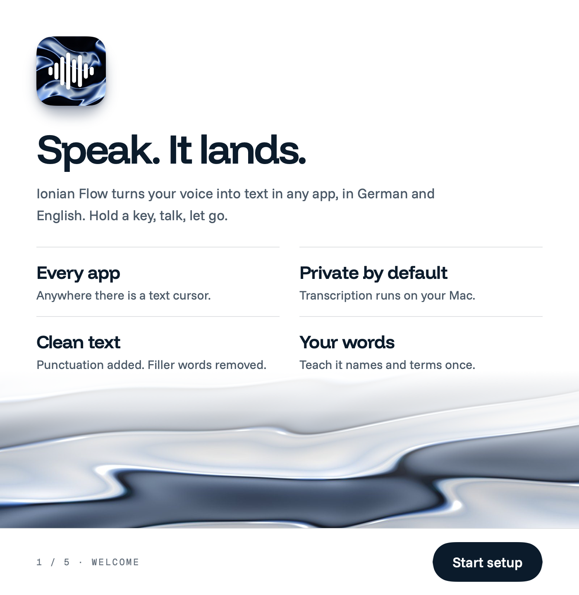
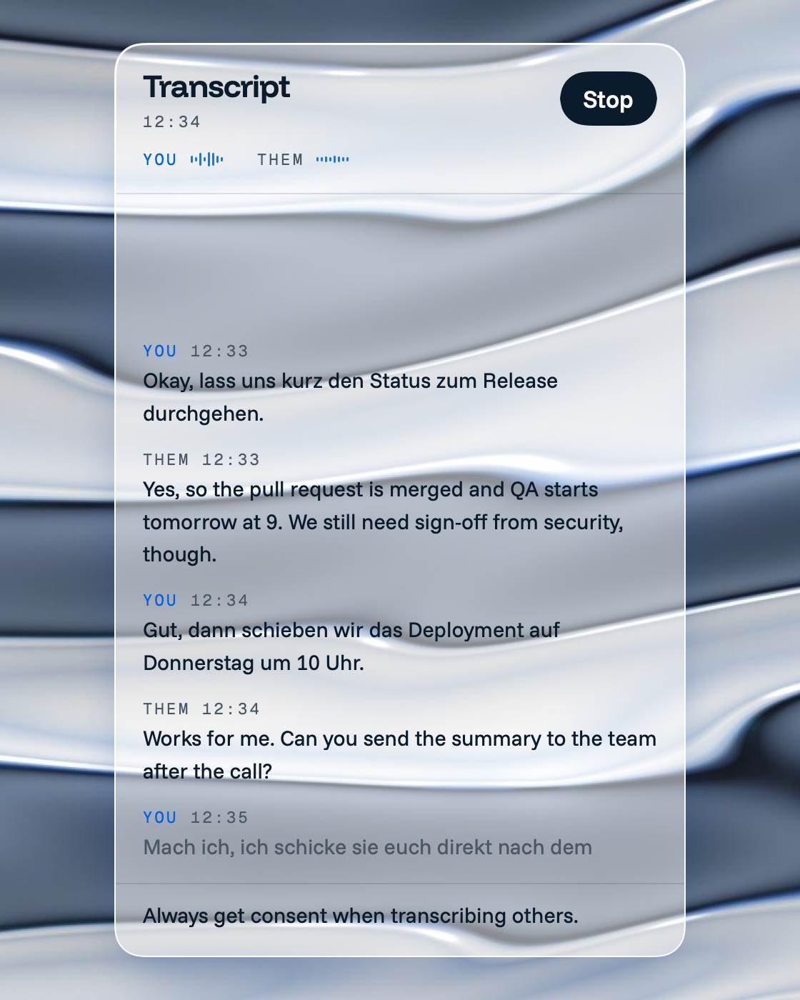
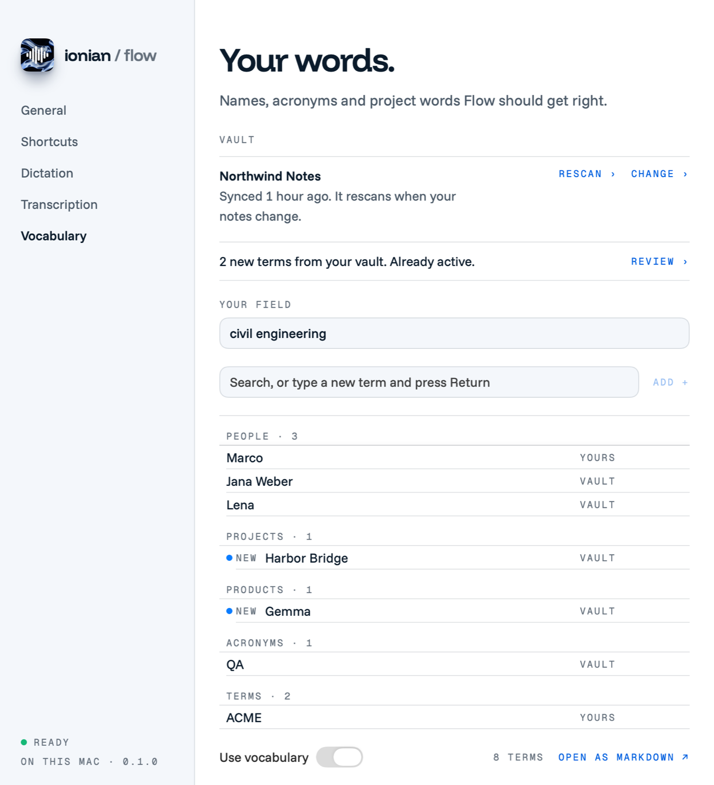
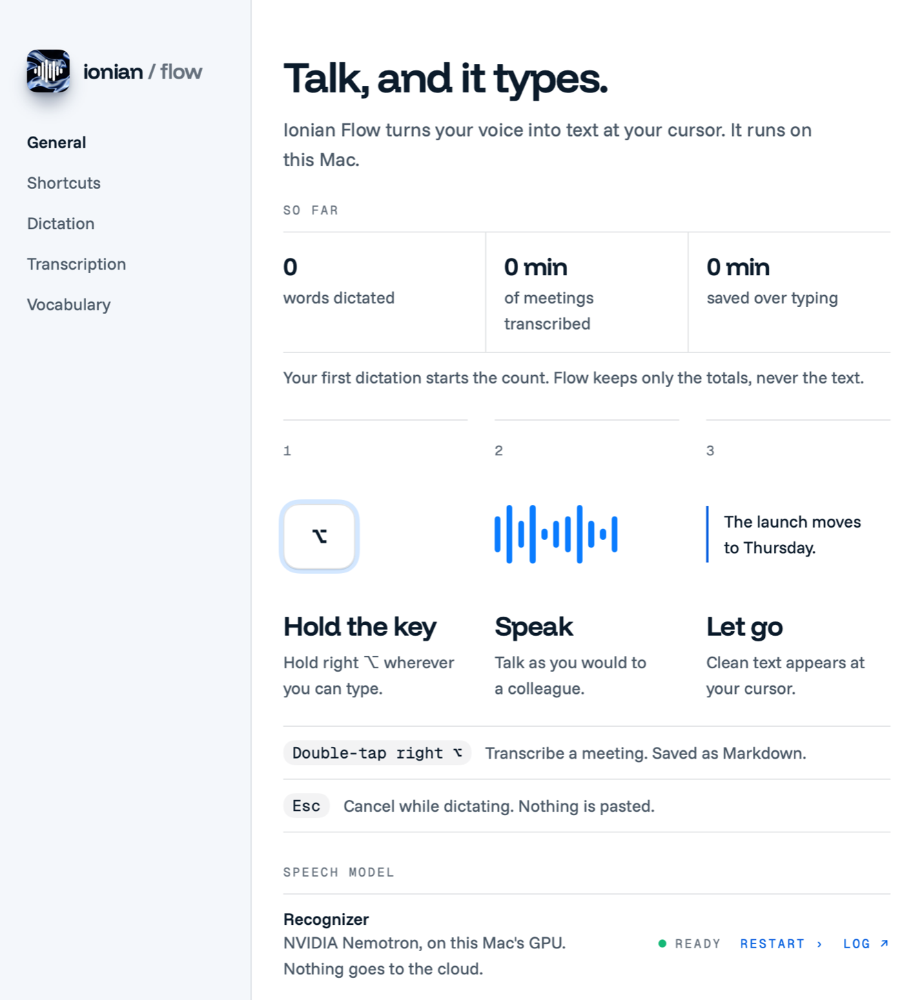

<picture>
  <source media="(prefers-color-scheme: dark)" srcset="docs/images/banner-dark.png">
  
</picture>

# Ionian Flow

Hold a key, talk, let go. The words appear where your cursor is.

Ionian Flow is dictation and meeting transcripts for the Mac, in German and English. Flow runs on your Mac, with no account and no cloud option. I built it for my own work. [ionian.dev/flow](https://ionian.dev/flow) has the short version.

<picture>
  <source media="(prefers-color-scheme: dark)" srcset="docs/images/dictation-dark.png">
  
</picture>

## What you get.
- **Every app.** Mail, chat, your browser, a code editor: wherever there is a text cursor.
- **Local.** Speech recognition and cleanup run on your Mac. No audio is stored.
- **German and English.** The language is detected each time you speak, so mixed sentences work.
- **Clean text.** Filler words go, lists get numbers, "new paragraph" does what it says.
- **Your words.** Names and terms from your Obsidian vault come out spelled right.
- **Meetings.** A side panel writes down you and the other side of a call as Markdown.
- **Free.** MIT licensed, no account, no subscription.

## Install it.
You need a Mac with Apple Silicon, macOS 15 or later, about 8 GB of free disk space, the Xcode command line tools (`xcode-select --install`) and [uv](https://docs.astral.sh/uv/) (`brew install uv`).

```bash
git clone https://github.com/ionianlabs/flow.git
cd flow
scripts/install.sh
```

The script sets up the Python environment, downloads the speech and cleanup models once (about 6 GB), builds `build/Ionian Flow.app` and opens it. To update, run `git pull` and the script again. It skips what is done, and macOS keeps your permissions.

## Set it up.
The first launch opens a setup guide.

<picture>
  <source media="(prefers-color-scheme: dark)" srcset="docs/images/setup-guide-dark.png">
  
</picture>

1. **Permissions**, one at a time, each with its reason. Microphone hears you, Accessibility pastes, Input Monitoring reads the key. System Audio is optional, for meetings.
2. **Your key.** Right ⌥ unless you pick another.
3. **Your words.** Connect an Obsidian vault or a folder of Markdown notes, or skip it.
4. **Try it** in a text field.

You can reopen the guide in Settings, on the General page.

## Dictate.
Hold right ⌥, talk, let go. The text lands at your cursor, and your clipboard stays as it was.

- Esc while holding cancels. Nothing is pasted.
- For hands-free, choose it in the menu bar, or give it a shortcut in Settings. Press the key to finish.
- If it pasted into the wrong place, choose Paste last dictation in the menu bar.
- Say "first, second" for a numbered list, or "new line" and "new paragraph" for layout.

## Transcribe a meeting.
Double-tap right ⌥ to start, and again to stop.

<picture>
  <source media="(prefers-color-scheme: dark)" srcset="docs/images/transcription-dark.png">
  
</picture>

- **You** is your microphone. **Them** is whatever your Mac plays, which is the call.
- The transcript saves as Markdown in `~/Documents/Ionian Flow/Transcripts` while it runs. You can change the folder.
- When you stop, Flow adds a summary with key points, decisions and action items.
- The panel never takes focus from your meeting app.

Always get consent before you transcribe other people.

## Teach it your words.
Open the Vocabulary page from the menu bar.

<picture>
  <source media="(prefers-color-scheme: dark)" srcset="docs/images/window-vocabulary-dark.png">
  
</picture>

Connect a vault once. Flow reads your notes and picks out names, products, acronyms and jargon. It rescans when your notes change, and new terms wait for your review. It only reads your vault and never changes it. You can also add terms by hand, or edit `~/Documents/Ionian Flow/Vocabulary.md`. On my benchmark of synthesized German and English speech, such terms came out right 64 % of the time instead of 36 %.

## Change the settings.
Choose Settings in the menu bar, or press ⌘, for the Ionian Flow window. It has pages for shortcuts, dictation language and microphone, and the transcripts folder.

<picture>
  <source media="(prefers-color-scheme: dark)" srcset="docs/images/window-general-dark.png">
  
</picture>

## Keep it private.
Transcription and cleanup run on your Mac. There is no cloud option. Only the model downloads go online: once during install, and once more (about 630 MB) the first time you transcribe a meeting. After that Flow runs offline. It keeps only totals, such as word counts, never your text.

## Questions.
**Why does the key do nothing?** Allow Accessibility and Input Monitoring, then restart Flow. macOS applies these two only to a fresh start.

**Why is Them silent in a call?** Allow Ionian Flow under System Settings, Privacy and Security, Screen and System Audio Recording.

**Can I use the globe key?** Yes. Set "Press globe key to" to Do Nothing in System Settings, Keyboard, or macOS also opens the emoji picker.

**Why is the first word cut off?** Turn on "Keep the mic ready for 30 s" on the Dictation page.

**Where are the logs?** In `~/Library/Logs/Ionian Flow/`.

## Build on it.
How it works, the benchmarks and every command are in [docs/DEVELOPMENT.md](docs/DEVELOPMENT.md).

## License.
Ionian Flow is MIT licensed, see [LICENSE](LICENSE). It builds on these:
- [FluidAudio](https://github.com/FluidInference/FluidAudio) runs Parakeet on the Neural Engine, under Apache-2.0.
- Funnel Display, Funnel Sans and Geist Mono are bundled under the SIL Open Font License 1.1, with the license texts in `app/Resources/Fonts`.
- [Nemotron 3.5 ASR Streaming 0.6B](https://huggingface.co/nvidia/nemotron-3.5-asr-streaming-0.6b) by NVIDIA is under the OpenMDW-1.1 license.
- [Parakeet Ultra](https://huggingface.co/FluidInference/parakeet-ultra-coreml), Moondream's post-training of NVIDIA's Parakeet TDT 0.6B v3 with a Core ML build by FluidInference, is under CC-BY-4.0.
- [Gemma 4 E2B](https://huggingface.co/mlx-community/gemma-4-e2b-it-4bit) by Google has its own terms, see the model page.

The models download from Hugging Face and are not part of this repository.
